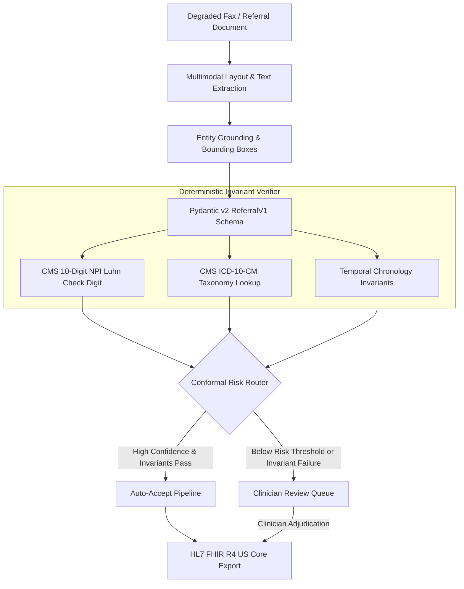

# Intake AI — Clinical Intelligent Document Processing Engine

[](LICENSE)
[](https://www.python.org/downloads/)
[](https://hl7.org/fhir/R4/)
[](https://www.cms.gov/)

An intelligent document processing (IDP) pipeline designed for degraded clinical faxes, referral forms, and ambulatory intake documents. Combines multimodal layout grounding with deterministic clinical invariants and conformal risk routing to achieve provable extraction reliability before exporting to standard HL7 FHIR R4 US Core bundles.

---

## The Clinical Intake Problem

Healthcare systems process millions of ambulatory referrals and prior authorization requests via analog fax networks (200 DPI, skewed, pepper noise, multi-generation thermal degradation). 

Standard unconstrained OCR or zero-shot Vision LLMs frequently hallucinate or misread high-liability numerical entities:
- **Provider NPIs**: Transposing a single digit routes claims and medical records to the wrong clinician.
- **ICD-10-CM Codes**: Subtle character substitution (e.g., `E11.9` Type 2 diabetes vs `E10.9` Type 1 diabetes) alters patient clinical pathways.
- **Chronology**: Misidentifying dates of birth vs referral dates creates catastrophic record linkage errors.

**Intake AI** replaces uncalibrated probabilistic extraction with a neuro-symbolic verification pipeline. Every extracted entity is grounded with normalized bounding boxes, subjected to deterministic algorithmic checks, and routed through a calibrated confidence threshold.

---

## Architectural Pipeline



---

## Core Capabilities

1. **Deterministic Invariant Verification**:
   - **CMS 10-digit NPI Validation**: Implements the ISO/IEC 7812 Luhn check-digit algorithm with the official CMS health-industry prefix constant (`80840`, prefix sum = 24).
   - **CMS ICD-10-CM Taxonomy Engine**: Validates both standard alphanumeric syntactic grammar (`[A-TV-Z][0-9][0-9A-B](\.[0-9A-TV-Z]{1,4})?`) and verifies codes against official outpatient diagnostic taxonomy registries.
   - **Temporal Chronology Invariants**: Enforces strict chronological ordering (`DOB < onset_date <= referral_date <= service_date`) to prevent date transposition.

2. **Full Evidence Grounding**:
   - All extracted clinical fields are wrapped in a generic `ClinicalEntity[T]` carrying normalized pixel coordinates `[ymin, xmin, ymax, xmax]` and confidence scores.
   - Bounding boxes enable exact spatial auditing in the clinician review terminal.

3. **Conformal Risk-Calibrated Routing**:
   - Fields that pass all deterministic checks and exceed statistical certainty thresholds are auto-accepted (Straight-Through Processing).
   - Ambiguous or failing fields are routed to the clinician review queue with spatial bounding-box overlays.

4. **Standards-Compliant Interoperability**:
   - Generates compliant HL7 FHIR R4 US Core bundles containing `Patient`, `Practitioner`, `Coverage`, `Condition`, and `ServiceRequest` resources with provenance metadata.

---

## Project Structure

```
01-intake/
├── src/
│   ├── __init__.py
│   ├── schema.py               # Pydantic v2 clinical models (ReferralV1, BoundingBox, ClinicalEntity)
│   └── clinical_verifier.py    # CMS NPI Luhn, ICD-10 taxonomy, & chronology verifiers
├── tests/
│   ├── test_schema_integrity.py     # Schema boundary & serialization assertions
│   └── test_clinical_verifier.py    # NPI, ICD-10, and temporal invariant tests
├── requirements.txt
├── .gitignore
└── README.md
```

---

## Getting Started

### Prerequisites
- Python 3.10 or higher

### Installation

```bash
git clone https://github.com/ManojDevarajulu/IntakeAI.git
cd IntakeAI
pip install -r requirements.txt
```

### Running Test Verification

The core schema and deterministic verifiers run with zero external test runners:

```bash
python tests/test_schema_integrity.py
python tests/test_clinical_verifier.py
```

---

## License

This project is licensed under the MIT License — see the [LICENSE](LICENSE) file for details.
